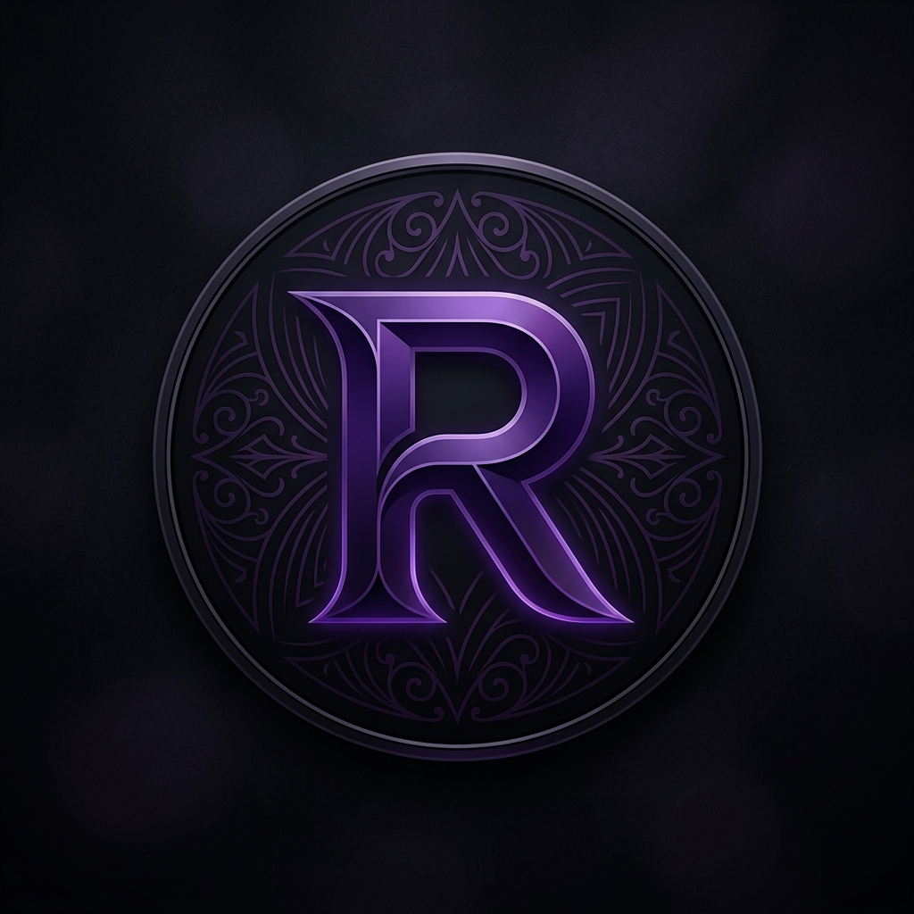

<div align="center">

<br>
<a href="https://www.patreon.com/Ripleytia"></a>
<a href="https://github.com/ripleytia/Ripleytia-AI-Cover/releases"></a>
<a href="https://github.com/ripleytia/Ripleytia-AI-Cover/stargazers"></a>
</div>

# 🎵 Ripleytia AI Sound Studio V3.5 - Cover, Otomatik Dataset & Ses Modelleme Merkezi

**Ripleytia AI Sound Studio**, yapay zeka müzik ve ses teknolojilerini tek bir çatı altında birleştiren yeni nesil bir **AI Ses Laboratuvarı**dır. **AI Cover Üretimi**, **Otomatik Dataset Hazırlayıcı**, **Profesyonel RVC Ses Modelleme (Eğitim)** ve **UVR5 Special 2 (SOTA Roformer & Vokal Kurtarma Kalkanı)** teknolojilerini tek tıkla kullanabileceğiniz modern ve şık bir stüdyodur.

---

## 🚀 V3.5 Sürümü ile Gelen Devrimsel Yenilikler

### 🛡️ 1. Akıllı Vokal Kurtarma Kalkanı (Intelligent Vocal Rescue & Ghosting Shield)
* **Problem:** Birçok şarkıda De-Reverb ve Karaoke modelleri oda yankısını veya geri vokalleri temizleyeceğim derken; sanatçının fısıltılarını, çift seslerini (double-track) ve kelime sonlarını yutuyor, vokal sönükleşip kaybolabiliyordu.
* **Devrimsel Çözüm:** 1. aşamadaki kusursuz `Becruily Vocals` emniyet referansı olarak hafızaya alınır. De-Reverb ve Karaoke sonrasında ses saniyede 40 kez (25ms aralıklarla) taranır. Yutulan veya zayıflayan her hece, **sıfır çıtırtı ve sıfır faz hatasıyla (sample-accurate linear crossfade)** orijinal vokalden yamalanarak onarılır. Vokal artık **asla yok olmaz ve dimdik ayakta kalır!**

### 🎛️ 2. UVR5 Special 2 (4 Aşamalı Ultra Roformer Hattı)
AI Cover ve Dataset hazırlama için dünyanın en güçlü modelleri bir arada:
1. **Mel-Band Roformer Vocals (Becruily):** Sıfır müzik sızıntısıyla ana vokal ayrıştırma.
2. **Mel-Band Roformer Instrumental (Becruily):** Stüdyo kalitesinde tertemiz enstrümantal çıkarma.
3. **Mel-Band Roformer Karaoke (Aufr33 & Viperx - SDR 10.19):** Ana vokali arkadaki koro ve adlib seslerinden ayırır.
4. **Mel-Band Roformer De-Reverb (Anvuew - SDR 19.17):** Oda akustiğini ve eko kalıntılarını sıfırlayarak kuru stüdyo kaydı elde eder.
5. **Vocal Rescue Shield Entegrasyonu:** Kayıp kelimeleri canlı yüzdeyle raporlar ve otomatik onarır.

### 🎙️ 3. Profesyonel Ses Modelleme (Eğitim Stüdyosu)
* **Tek Tıkla Hazır Eğitim Presetleri:**
  * **Dengeli (Önerilen - Stüdyo Standart):** 40kHz HiFi-GAN mimarisi ile hem AI Cover hem W-Okada canlı kullanım için ideal denge.
  * **Maksimum Kalite (Ultra Detay & Nefes):** 48kHz Ultra HD ve **TITAN-Medium** ön eğitim modeli ile en ince vokal detayları.
  * **Hızlı Render (Pratik & Hızlı Eğitim):** 32kHz, **FCPE** pitch ve **Ov2Super** modeli ile süper hızlı yakınsama.
  * **W-Okada / Canlı Konuşma & Discord:** Canlı ses değiştiricilerde mikrofondaki nefes patlamasını önleyen (`include_mutes=4`) ve **Snowie V3.1** modeli ile optimize edilmiş profil.
* **Akıllı Epoch Tavsiyesi:** Dataset süresini otomatik hesaplayarak ses bozulmadan (Overfitting olmadan) gereken en ideal Epoch sayısını belirler.
* **Otomatik Kurulum:** Model eğitildiği an `.pth` ve `.index` dosyaları stüdyoya eklenir, hemen cover yapmaya hazır hale gelir!

### 📂 4. Otomatik Dataset Hazırlayıcı (Auto Dataset Builder)
* Çoklu yerel dosya (`MP3, WAV, FLAC, MP4, MKV`) veya çoklu YouTube linki desteği.
* Modern **Python 3.12 / 3.14 yt-dlp köprüsü** ile 2026+ güncel YouTube altyapısı.
* 40 dB sessizlik budama, 75Hz Highpass filtre, ses dengeleme (normalization) ve otomatik konuşma segmentasyonu.
* **Gece Bırakma Modu:** Dataset biter bitmez eğitimi otomatik başlatma seçeneği!

### 💻 5. Tek Tıkla Kurulum Sihirbazı (Setup.exe)
* Uygulamanın modern **Gothic Purple / Dark Cyber** temasıyla birebir uyumlu kurulum sihirbazı.
* Python sanal ortamını (venv), CUDA PyTorch bağımlılıklarını ve temel modelleri otomatik yapılandırır.
* Masaüstüne **Ripleytia AI Studio** kısayolunu otomatik ekler.

---

## 📥 İndirme ve Hızlı Kurulum

1. [Releases (Sürümler)](https://github.com/ripleytia/Ripleytia-AI-Cover/releases) sayfasından en güncel **`Ripleytia_AI_Sound_Studio_V3.5_Setup.zip`** dosyasını indirin.
2. Zip içerisindeki **`Setup.exe`** dosyasını çalıştırın.
3. Kurulum klasörünü seçip **"Kurulumu Başlat"** butonuna tıklayın.
4. Kurulum tamamlandığında masaüstünüzdeki **Ripleytia AI Studio** kısayoluna çift tıklayarak stüdyonuzu hemen açabilirsiniz!

---

## 🛠️ Manuel Çalıştırma (Geliştiriciler İçin)

Projeyi klonladıktan sonra doğrudan başlatmak için:

```bash
# Projeyi klonlayın
git clone https://github.com/ripleytia/Ripleytia-AI-Cover.git
cd Ripleytia-AI-Cover

# Başlatıcıyı çalıştırın
Start-SuperGUI.bat
```

Veya Python sanal ortamından:

```bash
.\venv\Scripts\python.exe src\super_gui.py
```

---

## 💖 Projeye Destek Olun
Bu proje tamamen ücretsiz ve açık kaynaklıdır. Geliştirmelerin devam etmesi ve yeni özellikler için [Patreon sayfamı](https://www.patreon.com/Ripleytia) ziyaret edebilirsiniz!
